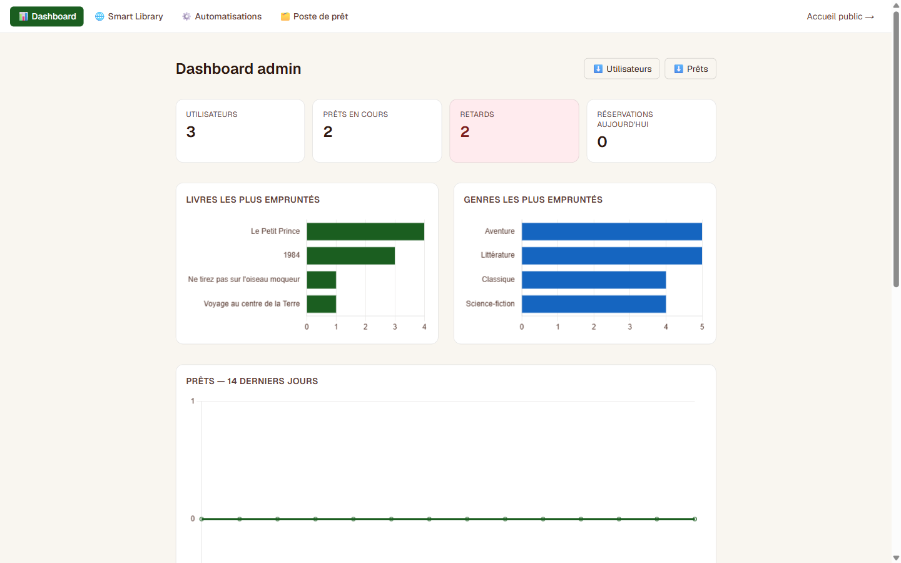
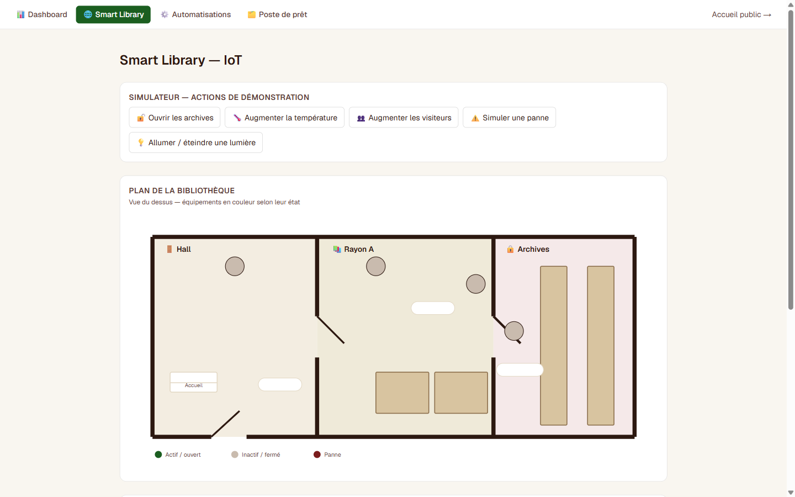
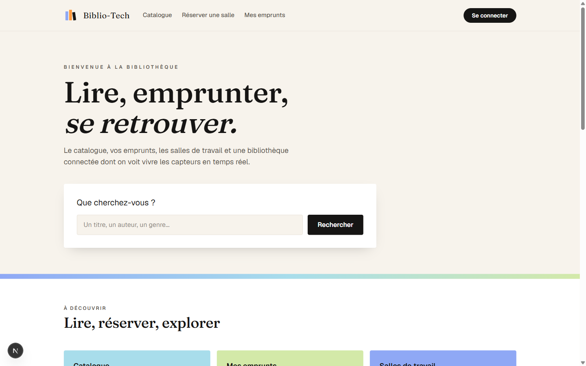
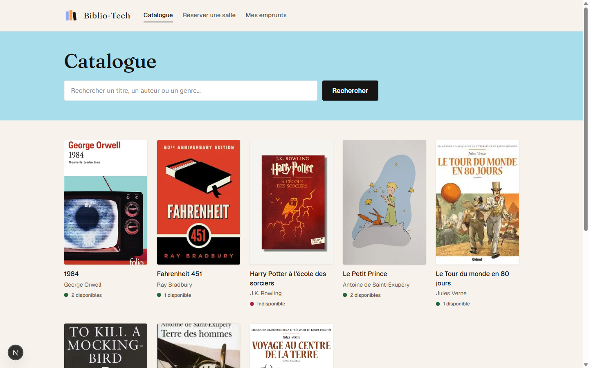

# Biblio-Tech

**Smart Library Management Platform** : une bibliothèque augmentée d'une couche domotique (IoT) simulée. Catalogue, prêts, réservations de salles, dashboard analytics, service Java de détection des retards, et un simulateur de capteurs/équipements pilotable en temps réel, sans aucun matériel physique.


**[Démo en ligne](https://bibliotheque1.vercel.app)** · **[API](https://bibliotheque1-jm6p.onrender.com/api/health)**

> Le backend est hébergé sur une offre gratuite qui se met en veille après 15 min d'inactivité : le premier chargement peut prendre 30 à 50 secondes.

## En bref

| | |
|---|---|
| **Quoi** | Application full-stack de gestion de bibliothèque, reconstruite à partir d'un ancien projet PHP audité |
| **Stack** | Next.js / React, API Node.js Express, service Java Spring Boot, PostgreSQL, Docker |
| **Qualité** | 12 tests d'intégration (Vitest + Supertest) sur une vraie base, 4 tests JUnit, dont un test qui prouve que deux employés ne peuvent pas prêter le même livre au même instant |
| **Sécurité** | JWT avec jeton de rafraîchissement en cookie httpOnly, bcrypt, validation Zod, en-têtes helmet, limite des tentatives de connexion |
| **Essayer** | [Démo en ligne](https://bibliotheque1.vercel.app) avec les comptes ci-dessous, ou `docker compose up --build` en local |

| Dashboard admin | Smart Library (IoT simulé) |
|---|---|
|  |  |

| Accueil | Catalogue |
|---|---|
|  |  |

---

## Comptes de démonstration

| Rôle | Email | Mot de passe |
|---|---|---|
| Usager | `claire@bibliotech.demo` | `demo1234` |
| Employé | `hugo@bibliotech.demo` | `demo1234` |
| Admin | `admin@bibliotech.demo` | `demo1234` |

## Le projet

Biblio-Tech est la reconstruction complète d'un projet universitaire PHP/MySQL en une application moderne full-stack. L'ancienne version (conservée dans [`/legacy-php`](legacy-php) comme référence) a d'abord été **auditée** : bugs de sécurité (mots de passe en clair, faille de modélisation des rôles), schéma SQL incohérent, fonctionnalités inachevées. Ce diagnostic a servi de base à une reconstruction complète, avec une stack et une architecture pensées pour être démontrables en production, sans jamais dépendre d'un Raspberry Pi ou d'un matériel domotique réel.

## Fonctionnalités

**Usager** : catalogue avec recherche, emprunts, réservation de salles, recommandations personnalisées (calculées en SQL pur : genres/auteurs déjà lus, popularité, nouveautés).

**Employé** : poste de prêt (enregistrer un emprunt/retour), dashboard Smart Library en lecture (capteurs, alertes).

**Admin** : gestion des rôles, dashboard analytics (livres/genres populaires, tendances, KPIs), export CSV, pilotage complet de la couche IoT (équipements, scénarios de démonstration, automatisations, sécurité des archives).

### La couche Smart Library

- **Simulateur déterministe** : chaque valeur de capteur (température, humidité, luminosité, occupation...) est recalculée à la demande à partir de l'heure du jour, sans processus qui doit tourner en continu. L'historique des graphiques se reconstitue automatiquement au premier appel après une période d'inactivité.
- **5 scénarios de démonstration** : ouverture des archives, hausse de température, afflux de visiteurs, panne d'équipement, bascule d'éclairage.
- **Automatisations IF / THEN** : règles stockées en base (ex. *température > 27°C, alors ventilation*), évaluées en direct et journalisées.
- **Sécurité des archives** : détection d'ouverture hors horaires, puis événement, puis alerte, avec historique conservé.
- **Plan interactif** : visualisation des zones (Hall, Rayon A, Archives) avec équipements positionnés et colorés selon leur état.

## Architecture

```
                 navigateur
                     │
                     ▼
   ┌───────────────────────────────────┐
   │  Front Next.js (Vercel)           │
   └─────────────────┬─────────────────┘
                     │ HTTP + JSON (JWT)
                     ▼
   ┌───────────────────────────────────┐      ┌──────────────────────────────┐
   │  API REST Node.js / Express       │      │  Service de relances Java    │
   │  (Render)                         │      │  Spring Boot                 │
   │  routes → controllers → services  │      │  GET /api/reminders/overdue  │
   │  → repositories (SQL avec pg)     │      │  + tâche planifiée à 8 h     │
   └─────────────────┬─────────────────┘      └──────────────┬───────────────┘
                     │ lecture / écriture                    │ lecture seule
                     ▼                                       ▼
   ┌──────────────────────────────────────────────────────────────────────────┐
   │                            PostgreSQL                                    │
   └──────────────────────────────────────────────────────────────────────────┘
```

- **Front Next.js** : pages par rôle, appelle uniquement l'API Express.
- **API Express** : toute la logique métier (auth, catalogue, prêts, réservations, IoT). C'est la seule à écrire dans la base.
- **Service Java** : un service séparé, en lecture seule, qui détecte les emprunts en retard. Il peut évoluer (envoi d'e-mails, autre rythme de déploiement) sans toucher à l'API.
- **PostgreSQL** : base partagée. En production, hébergée sur Neon ; en local, lancée par Docker Compose.

## Stack technique

| Couche | Choix | Pourquoi |
|---|---|---|
| Frontend | Next.js 16.3 (App Router) + React 19.2, Tailwind CSS 4 | Déploiement Vercel natif, très reconnu |
| Backend | Node.js (≥ 18.18) + Express 4.19, architecture en couches (routes → controllers → services → repositories) | Explicite, sans magie |
| Base de données | PostgreSQL (Neon, serverless), client `pg` 8.12 | SQL brut visible dans les repositories, pas d'ORM qui masque la logique |
| Service de relances | Java 21, Spring Boot 3.3, `JdbcTemplate`, Maven | Règle métier isolée et testée, SQL visible (pas de JPA) |
| Graphiques | Chart.js 4.5 via react-chartjs-2 5.3 | KPIs, tendances, historique capteurs |
| Auth | JWT 9.0 (access + refresh en cookie httpOnly) + bcryptjs 3.0 | Stateless, adapté à deux domaines séparés (Vercel/Render) |
| Sécurité HTTP | helmet 8.1, express-rate-limit 7.5 | En-têtes de sécurité, 10 tentatives de connexion par 15 min et par IP |
| Validation | Zod 3.23 sur les entrées de l'API | Les erreurs de saisie sont rejetées avant d'atteindre les services |
| Tests | Vitest 3.2 + Supertest 7.1 (API), JUnit 5 + AssertJ (Java) | Tests d'intégration sur une vraie base PostgreSQL |
| Conteneurs | Docker, Docker Compose | Base, API et service Java lancés en une commande |
| Déploiement | Vercel (frontend) + Render (backend) | Gratuit, CI/CD intégrée |

## Démarrer en local

### Avec Docker (le plus simple)

Prérequis : Docker Desktop.

```bash
cp .env.example .env     # puis remplacer les valeurs "change-moi"
docker compose up --build
```

Cette commande lance trois conteneurs :

| Service | Rôle | Adresse |
|---|---|---|
| `db` | PostgreSQL 16, données gardées dans le volume `db-data` | non exposée hors de Docker |
| `api` | API Express ; applique la migration et les données de démo au démarrage | http://localhost:4000/api/health |
| `reminders` | Service Java de relances | http://localhost:8081/api/reminders/overdue |

Le front se lance à part (voir plus bas). `docker compose down` arrête tout ; `docker compose down -v` efface aussi la base.

### Sans Docker

```bash
# Backend
cd v2/backend
npm install
cp .env.example .env   # renseigner DATABASE_URL (Postgres), JWT secrets
npm run migrate
npm run seed            # crée le schéma + données de démo
npm run dev              # http://localhost:4000

# Frontend (dans un autre terminal)
cd v2/frontend
npm install
cp .env.local.example .env.local   # NEXT_PUBLIC_API_URL=http://localhost:4000
npm run dev              # http://localhost:3000
```

## Tests

### API Node.js (Vitest + Supertest)

Tests d'intégration : chaque requête traverse toute la chaîne (route, middleware, contrôleur, service, repository) jusqu'à une vraie base PostgreSQL. Cette base de test est **entièrement effacée** puis recréée (migration + seeds) avant chaque lancement ; un garde-fou refuse de démarrer si elle n'est pas sur `localhost`.

```bash
# 1. Base de test jetable (port 5433 pour ne pas gêner une autre base)
docker run --name biblio-test-db -e POSTGRES_PASSWORD=test -e POSTGRES_DB=biblio_test -p 5433:5432 -d postgres:16

# 2. Lancer les tests
cd v2/backend
cp .env.test.example .env.test
npm test
```

Ce qui est vérifié :

- connexion valide (200 + jeton, cookie `HttpOnly`), mot de passe faux (401) ;
- route protégée sans jeton (401), route employé appelée par un usager (403) ;
- emprunt d'un exemplaire disponible (201), puis du même exemplaire (409) ;
- **10 emprunts simultanés du même exemplaire : un seul réussit**. Le test au niveau du repository échoue si l'on retire le `SELECT ... FOR UPDATE`, ce qui prouve que c'est bien le verrou qui empêche le double prêt ;
- réservation invalide rejetée par Zod (400) ;
- en-têtes helmet, effacement du cookie à la déconnexion, 11e tentative de connexion bloquée (429).

### Service Java (JUnit 5)

```bash
cd v2/reminders-service
./mvnw test        # Windows : .\mvnw.cmd test
```

Le Maven Wrapper (`mvnw`) télécharge Maven tout seul : seul un JDK 21 ou plus récent est nécessaire.

## Service de relances (Java)

Dossier [`v2/reminders-service`](v2/reminders-service). Un petit service Spring Boot qui lit la même base que l'API et repère les emprunts non rendus dont la date d'échéance est dépassée.

| Classe | Rôle |
|---|---|
| `OverdueRule` | Règle métier pure, sans Spring ni base : un emprunt est en retard s'il n'est pas rendu et que la date du jour est après l'échéance (le jour même de l'échéance n'est pas un retard). |
| `LoanRepository` | Lit les emprunts non rendus en SQL avec `JdbcTemplate`. |
| `OverdueService` | Applique la règle aux emprunts lus et calcule les jours de retard. |
| `OverdueReportJob` | Tâche `@Scheduled` : chaque jour à 8 h (et une fois au démarrage), écrit dans les logs le nombre d'emprunts en retard. |
| `RemindersController` | Route `GET /api/reminders/overdue`. |

Exemple de réponse avec les données de démonstration :

```json
[
  {
    "loanId": 101,
    "copyId": 3,
    "bookTitle": "Voyage au centre de la Terre",
    "userId": 2,
    "userName": "Hugo Lefevre",
    "dueDate": "2026-11-07",
    "daysOverdue": 6
  }
]
```

Lancement sans Docker (base locale de docker-compose par défaut, sinon variables `DB_URL`, `DB_USER`, `DB_PASSWORD`) :

```bash
cd v2/reminders-service
./mvnw spring-boot:run   # http://localhost:8081/api/reminders/overdue
```

## Structure du dépôt

```
├── docker-compose.yml   # base + API + service Java en local
├── legacy-php/          # version originale PHP/MySQL (référence historique, non maintenue)
└── v2/
    ├── backend/         # API REST Express
    │   ├── src/
    │   │   ├── app.js           # crée l'application Express (sans listen)
    │   │   ├── server.js        # démarre le serveur
    │   │   ├── routes/        controllers/     services/
    │   │   ├── repositories/  database/        middleware/
    │   └── tests/       # tests d'intégration Vitest
    ├── reminders-service/   # service Java Spring Boot
    │   └── src/main/java/fr/bibliotech/reminders/
    └── frontend/        # Next.js App Router
        └── src/
            ├── app/            # pages par rôle
            ├── components/     services/       context/
```

## Notes de conception

- **Recommandations sans ML** : un score pondéré 100 % SQL (genres × 2, auteurs × 3, popularité × 1, nouveauté +1), volontairement simple et explicable.
- **Simulateur plutôt que hardware réel** : pensé dès le départ pour un hébergement gratuit qui met le service en veille ; les valeurs sont des fonctions pures du temps, pas un état qui doit persister.
- **Rôles verrouillés côté serveur** : l'inscription publique ne crée que des comptes usager ; seul un admin peut promouvoir un compte employé/admin (corrige une faille identifiée dans l'ancien projet).
- **Emprunts concurrents** : l'emprunt se fait dans une transaction qui verrouille la ligne de l'exemplaire (`SELECT ... FOR UPDATE`). Si deux employés prêtent le même livre au même instant, le second attend la fin de la première transaction, voit l'exemplaire indisponible et reçoit une erreur 409.
- **Règle de retard isolée** : côté Java, la règle est une classe sans dépendance, testée en quelques millisecondes ; le SQL ne fait que lire les emprunts non rendus.
